# PetBuddies API — Challenge FIAP 2026 | .NET

API REST desenvolvida com ASP.NET Core e EF Core — Challenge de **Advanced Business Development with .NET (2TDS)**, FIAP 2026.

O serviço é o **back-office administrativo da clínica veterinária**: é onde se configura o catálogo de protocolos de cuidado, o que a clínica oferece e por quanto, e quanto cada gesto do tutor vale em pontos. O `petbuddies-ai` (Java) consome o catálogo daqui por HTTP ao montar o plano de cuidado de um animal.

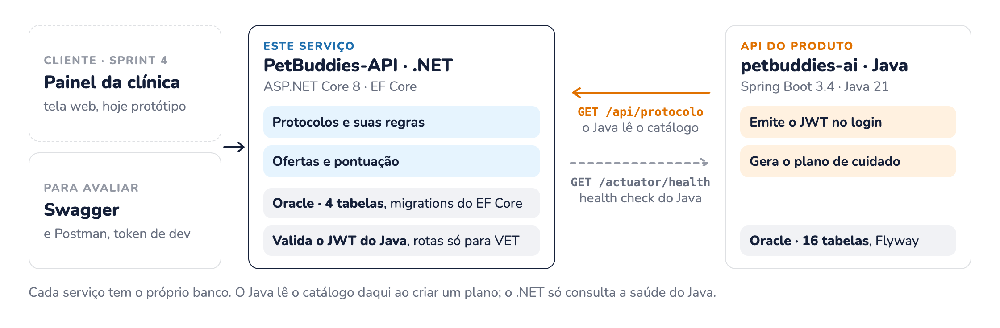

Nesta sprint a API ganhou [health checks](#health-checks) do banco e do serviço Java, [log estruturado com correlação de requisições, tracing e métricas](#observabilidade) com Serilog e OpenTelemetry, e [testes automatizados](#via-testes-automatizados) unitários e de integração no padrão AAA.

Ganhou também a [pontuação do responsável](#pontuação-do-responsável): a cada consulta realizada, o Java avisa este serviço, que aplica as regras de pontuação da clínica, grava os pontos no Oracle e guarda a memória do cálculo num banco **NoSQL (MongoDB)**.

---

## Índice

1. [Integrantes do Grupo](#integrantes-do-grupo)
2. [Stack e Dependências](#stack-e-dependências)
3. [Estrutura do Projeto](#estrutura-do-projeto)
4. [Como Executar](#como-executar)
5. [Modelo de dados](#modelo-de-dados)
6. [Pontuação do responsável](#pontuação-do-responsável)
7. [Recursos e Rotas](#recursos-e-rotas)
8. [Autenticação](#autenticação)
9. [Observabilidade](#observabilidade)
10. [Como Testar](#como-testar)
11. [Exemplos de Payload (POST)](#exemplos-de-payload-post)

---

## Links

| | |
|---|---|
| Swagger UI (local) | `http://localhost:5297/swagger` |
| Postman collection | [`docs/postman/petbuddies-api-net.postman_collection.json`](docs/postman/petbuddies-api-net.postman_collection.json) |
| Serviço Java (opcional para avaliar este) | [3BugBuddies/PetBuddies-AI](https://github.com/3BugBuddies/PetBuddies-AI) |

---

## Integrantes do Grupo

| Nome | RM |
|------|----|
| Felipe Yuiti Ishii | 565339 |
| Gabriel Nogueira Peixoto | 563925 |
| Giovanna Neri dos Santos | 566154 |
| Mariana Inoue | 565834 |

---

## Stack e Dependências

| Pacote | Versão | Descrição |
|--------|--------|-----------|
| Microsoft.EntityFrameworkCore | 8.0.26 | ORM principal |
| Oracle.EntityFrameworkCore | 8.23.26200 | Driver Oracle para EF Core |
| Microsoft.AspNetCore.Authentication.JwtBearer | 8.0.26 | Validação do JWT emitido pelo Java |
| Serilog.AspNetCore | 8.0.3 | Log estruturado (console + arquivo JSON compacto) |
| OpenTelemetry.Extensions.Hosting + instrumentações (AspNetCore, Http, EntityFrameworkCore) | 1.18.0 / 1.18.0-beta.1 | Tracing e métricas |
| AspNetCore.HealthChecks.Oracle | 8.0.1 | Health check de conexão com o Oracle |
| AspNetCore.HealthChecks.Uris | 8.0.1 | Health check do serviço Java (`/actuator/health`) |
| MongoDB.Driver | 2.30.0 | Driver do MongoDB — memória de cálculo da pontuação (NoSQL) |
| AspNetCore.HealthChecks.MongoDb | 8.1.0 | Health check de conexão com o MongoDB |
| Swashbuckle.AspNetCore + Annotations | 6.6.2 | Swagger / OpenAPI UI |

**Testes** (só nos projetos `.Tests.*`): xUnit 2.9.3, Moq 4.20.72, Microsoft.EntityFrameworkCore.InMemory 8.0.26, Microsoft.AspNetCore.Mvc.Testing 8.0.26.

---

## Estrutura do Projeto

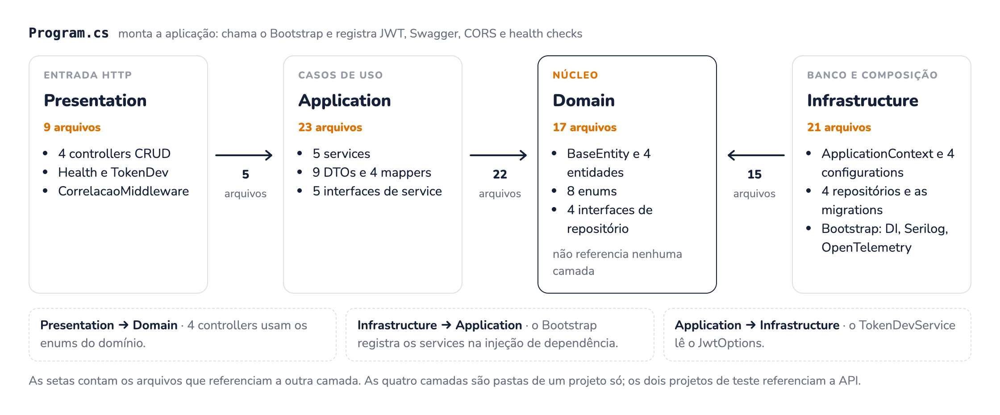

<details>
<summary>Árvore de pastas</summary>

```
PetBuddies-API/
├── docs/
│   └── postman/
│       └── petbuddies-api-net.postman_collection.json
├── PetBuddies-API/
│   ├── Domain/
│   │   ├── Entities/        # BaseEntity + 5 entidades (Protocolo, RegraProtocolo, Oferta, RegraPontuacao, LancamentoPontos)
│   │   ├── Documents/       # MemoriaCalculoDocument — documento do MongoDB, sem atributo do driver
│   │   ├── Enums/           # 9 enums de domínio
│   │   └── Interfaces/      # Contratos de repositório (IXxxRepository)
│   ├── Application/
│   │   ├── Dtos/            # Um subpacote por domínio: XxxDto + SalvarXxxRequest
│   │   ├── Interfaces/      # Contratos de service (IXxxService)
│   │   ├── Mappers/         # Entidade ↔ DTO, um por domínio
│   │   └── UseCases/        # Services — validação de shape + regra de negócio
│   ├── Infrastructure/
│   │   ├── Data/
│   │   │   ├── ApplicationContext.cs
│   │   │   ├── Configurations/  # IEntityTypeConfiguration<T>, um por entidade
│   │   │   ├── Converters/
│   │   │   └── Migrations/      # Migrations EF Core
│   │   ├── IoC/
│   │   │   └── Bootstrap.cs     # Injeção de dependência, Serilog, OpenTelemetry e cliente do MongoDB
│   │   ├── Mongo/           # MongoDbOptions, mapeamento BSON e MemoriaCalculoRepository
│   │   ├── Repositories/    # Um repositório por domínio
│   │   └── Security/
│   │       └── JwtOptions.cs
│   ├── Presentation/
│   │   ├── Controllers/     # 4 controllers REST, um por domínio, o PontuacaoController, o HealthController e o TokenDevController
│   │   ├── Conventions/
│   │   │   └── ApenasEmDesenvolvimento.cs  # tira o TokenDevController das rotas fora de Development
│   │   ├── Middlewares/
│   │   │   └── CorrelacaoMiddleware.cs
│   │   ├── HealthCheckResponseWriter.cs
│   │   └── LimiteDeRequisicoes.cs   # nome e limites da política de rate limit
│   ├── appsettings.json
│   ├── appsettings.Development.json
│   └── Program.cs
├── PetBuddies-API.Tests.Unit/          # Repository, Service e Mapper — EF Core InMemory + Moq
├── PetBuddies-API.Tests.Integration/   # Controller (Service mockado) + Autenticação (app real)
├── docker-compose.yml       # Sobe o Oracle e o MongoDB de desenvolvimento
├── Dockerfile
└── README.md
```

</details>

---

## Como Executar

### Pré-requisitos

- .NET 8 SDK
- Docker (para o Oracle e o MongoDB de desenvolvimento) **ou** acesso ao Oracle FIAP e a um MongoDB

### 1. Bancos de dados

O `docker-compose.yml` sobe **só os bancos**: o Oracle na porta `1522` e o MongoDB na `27017`. A aplicação roda no terminal.

```bash
docker compose up -d          # sobe os bancos
docker compose down -v        # derruba e apaga os volumes
```

Alternativa: o Oracle FIAP, exportando `ConnectionStrings__Oracle` (passo 2) com `User Id` = seu RM e `Password` = a senha do Oracle FIAP.

Sem MongoDB a API sobe e funciona igual; só a memória de cálculo da pontuação não é gravada, e `/health/mongo` responde `503`.

### 2. Variáveis de ambiente

**Para rodar localmente, nenhuma.** O `appsettings.Development.json` já traz a connection string do
Oracle do `docker-compose.yml` e um `PETBUDDIES_JWT_SECRET` de desenvolvimento. Esse arquivo só é
lido em `Development`: em qualquer outro ambiente o segredo precisa vir da variável, e sem ela a
subida falha (`ValidateOnStart`).

Exporte só para trocar um desses valores — a variável de ambiente vence o arquivo (`__` separa seção de chave):

| Variável | Quando exportar |
|---|---|
| `ConnectionStrings__Oracle` | para usar o Oracle FIAP no lugar do container |
| `PETBUDDIES_JWT_SECRET` | para aceitar o token do Java: o valor precisa ser o mesmo configurado lá, com no mínimo 32 caracteres |
| `MotorApi__BaseUrl` | se o Java não estiver em `http://localhost:8080` — usado **só** pelo health check `/health/externo` |
| `MongoDb__ConnectionString` | se o MongoDB não estiver em `mongodb://localhost:27017` — na Azure, a connection string do Cosmos DB |
| `MongoDb__Database` | para trocar o banco do MongoDB (padrão `petbuddies`) |

```bash
export ConnectionStrings__Oracle='Data Source=oracle.fiap.com.br:1521/ORCL;User Id=<RM>;Password=<senha>'
```

Use aspas simples: a connection string tem espaço, e sem elas o shell a corta em `Data`.

### 3. Rodando

```bash
dotnet run --project PetBuddies-API
```

No startup, `Program.cs` executa `Database.Migrate()` e aplica as migrations pendentes.

A aplicação sobe em:
- **HTTP:** `http://localhost:5297`
- **Swagger UI:** `http://localhost:5297/swagger`

### 4. Pegue um token

Toda rota de negócio exige token, e **não é preciso subir o Java para isso**: a própria API emite
um token de desenvolvimento.

```bash
curl -s -X POST http://localhost:5297/api/dev/token | jq -r .token
```

No Swagger e no Postman o caminho é o mesmo — detalhe em [Autenticação](#autenticação).

---

## Modelo de dados

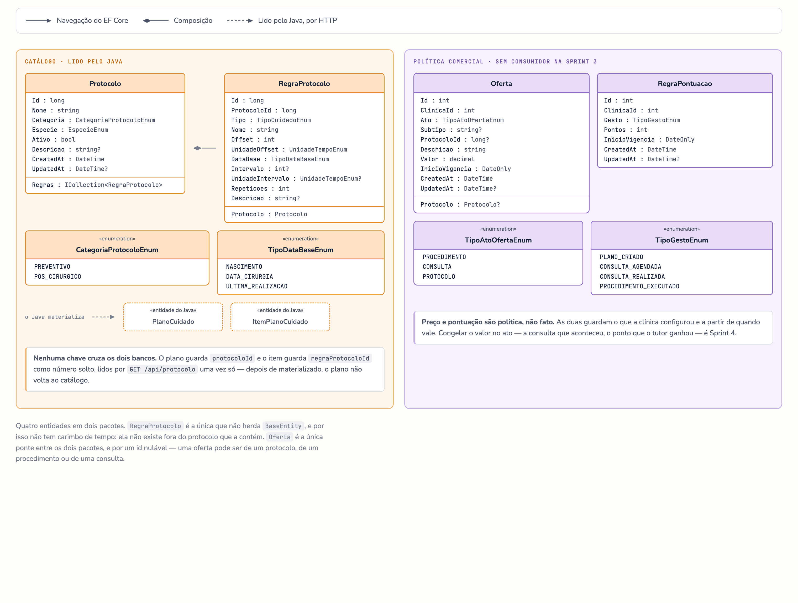

Cinco entidades em três grupos: o **catálogo** (protocolo e suas regras), lido pelo Java quando
um plano de cuidado nasce, a **política comercial** (oferta e regra de pontuação) e os **pontos
do responsável** (lançamento por consulta). O diagrama acima ainda não mostra o `LancamentoPontos`,
que não tem relação com as outras quatro — o desenho dele está em
[Pontuação do responsável](#pontuação-do-responsável).

| Entidade | Tabela | Papel |
|---|---|---|
| `ProtocoloEntity` | `T_PB_PROTOCOLO` | o molde de cuidado: categoria e espécie a que se aplica |
| `RegraProtocoloEntity` | `T_PB_REGRA_PROTOCOLO` | o item do molde — tipo de cuidado, deslocamento, data-base e recorrência |
| `OfertaEntity` | `T_PB_OFERTA` | o que a clínica oferece e por quanto, com vigência |
| `RegraPontuacaoEntity` | `T_PB_REGRA_PONTUACAO` | quanto cada gesto do tutor vale, por clínica e vigência |
| `LancamentoPontosEntity` | `T_PB_LANCAMENTO_PONTOS` | quantos pontos o responsável ganhou numa consulta; o saldo é a soma |

Fora do Oracle, a **memória de cálculo** de cada lançamento fica no MongoDB, na coleção
`memorias_calculo` (ver [Pontuação do responsável](#pontuação-do-responsável)).

### Invariantes que o schema garante

- `Oferta` — `UX_OFERTA_VIGENCIA` (único por clínica + ato + subtipo/protocolo + início de
  vigência) e o `CHECK` `CK_OFERTA_ALVO`: ato `PROCEDIMENTO`/`CONSULTA` exige `Subtipo` e proíbe
  `ProtocoloId`; ato `PROTOCOLO` faz o inverso.
- `RegraPontuacao` — `UK_PONTUACAO_VIGENCIA` (único por clínica + gesto + início de vigência).
- `RegraProtocolo` — `CK_REGPROT_RECORRENCIA`: `Intervalo` e `UnidadeIntervalo` são ambos nulos
  ou ambos preenchidos.
- `LancamentoPontos` — `UK_LANCAMENTO_CONSULTA` (um lançamento por consulta: a mesma consulta não
  pontua duas vezes) e `CK_LANCAMENTO_PONTOS` (`NR_PONTOS >= 0`).

---

## Pontuação do responsável

Depois de cada consulta realizada, o responsável (tutor) ganha pontos pelo cuidado que teve com o
animal desde a consulta anterior: os check-ins que fez nas doses do tratamento e a evolução que a
veterinária observou na consulta. Consulta cancelada não pontua, e a mesma consulta nunca pontua
duas vezes.

O **Java** conhece os fatos (consultas, doses, check-ins) e o **.NET** conhece as regras: o Java manda
as contagens do período, e o cálculo, as regras vigentes e o saldo ficam aqui.

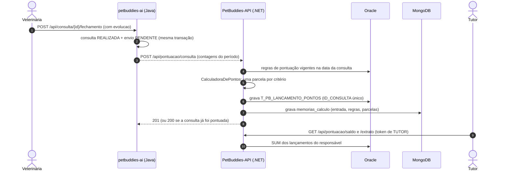

Se o .NET estiver fora do ar no fechamento, o envio fica `PENDENTE` no Java e é refeito a cada
5 minutos; como a consulta é única no lançamento, reenviar nunca duplica pontos.

### Como os pontos são calculados

Cada critério é um **gesto** da `RegraPontuacao`, então a clínica configura quanto vale cada um pela
rota `/api/regra-pontuacao`. Vale a regra de início de vigência mais recente até a data da consulta;
critério sem regra vigente vale zero.

| Gesto | Quando pontua | Pontos |
|---|---|---|
| `CONSULTA_REALIZADA` | toda consulta pontuada | valor da regra |
| `CHECKIN_REGISTRADO` | cada dose do período com check-in do tutor | valor da regra × doses com check-in |
| `ADESAO_COMPLETA` | 90% ou mais das doses previstas tiveram check-in | valor da regra |
| `EVOLUCAO_POSITIVA` | a veterinária marcou `MELHOROU` no fechamento | valor da regra |

Evolução `ESTAVEL` ou `PIOROU` não tira pontos: o programa não tem ponto negativo (`CK_PONTUACAO_PONTOS`).

### Onde fica cada dado

- **Oracle — `T_PB_LANCAMENTO_PONTOS`:** o valor oficial, um lançamento por consulta. O saldo do
  responsável é a soma dos lançamentos dele.
- **MongoDB — coleção `memorias_calculo`:** a explicação do número. Um documento por consulta
  pontuada, com o que o Java enviou, as regras usadas e quanto cada critério rendeu. O formato é
  livre (os critérios podem mudar sem migration) e aninhado (listas de parcelas), por isso NoSQL.

```json
{
  "_id": "6730f1c2a4b5d6e7f8091a2b",
  "consultaId": 42,
  "lancamentoId": 7,
  "responsavelId": 1,
  "animalId": 3,
  "clinicaId": 1,
  "periodo": { "de": "2026-09-01T10:00:00Z", "ate": "2026-10-01T14:30:00Z" },
  "entrada": {
    "dosesPrevistas": 20, "dosesComCheckin": 18, "diasNoPeriodo": 30,
    "diasComCheckin": 17, "acionamentosClinica": 1, "evolucao": "MELHOROU"
  },
  "parcelas": [
    { "gesto": "CONSULTA_REALIZADA", "quantidade": 1,  "pontosPorUnidade": 10, "pontos": 10, "regraId": 4, "observacao": "Consulta realizada." },
    { "gesto": "CHECKIN_REGISTRADO", "quantidade": 18, "pontosPorUnidade": 1,  "pontos": 18, "regraId": 5, "observacao": "18 de 20 doses com check-in no período." },
    { "gesto": "ADESAO_COMPLETA",    "quantidade": 1,  "pontosPorUnidade": 15, "pontos": 15, "regraId": 6, "observacao": "Adesão de 90%; mínimo para o bônus: 90%." },
    { "gesto": "EVOLUCAO_POSITIVA",  "quantidade": 1,  "pontosPorUnidade": 0,  "pontos": 0,  "regraId": null, "observacao": "Evolução informada: MELHOROU. Sem regra vigente para a clínica na data da consulta." }
  ],
  "total": 43,
  "calculadoEm": "2026-10-01T14:31:02Z"
}
```

Índices da coleção: `ux_consulta` (único em `consultaId`) e `ix_responsavel`. São criados no
primeiro uso, então a API sobe mesmo com o MongoDB fora do ar. O lançamento no Oracle é gravado
antes: se o MongoDB falhar, os pontos valem e a falha vai para o log.

Na Azure o MongoDB é um **Azure Cosmos DB for MongoDB**, criado pelo `infra/infra-app.sh`; a
connection string vai para a variável secreta `MONGODB_CONNECTION_STRING` da pipeline, que a grava
no Web App como `MongoDb__ConnectionString`.

---

## Recursos e Rotas

> As rotas do back-office exigem token JWT com role `VET` (`[Authorize(Roles = "VET")]`); as de pontuação variam por rota, na tabela abaixo — ver [Autenticação](#autenticação).

| Recurso | Rotas | Filtros de listagem | Status codes |
|---|---|---|---|
| Protocolo | `GET` `POST` `/api/protocolo`<br>`GET` `PUT` `DELETE` `/api/protocolo/{id}` | `especie`, `categoria`, `ativo` | `200` `201` `204` `400` `404` `409` `429` |
| RegraProtocolo | `GET` `POST` `/api/regra-protocolo`<br>`GET` `PUT` `DELETE` `/api/regra-protocolo/{id}` | `protocoloId` (obrigatório na listagem) | `200` `201` `204` `400` `404` `409` `429` |
| Oferta | `GET` `POST` `/api/oferta`<br>`GET` `PUT` `DELETE` `/api/oferta/{id}` | `clinicaId`, `ato` | `200` `201` `204` `400` `404` `409` `429` |
| RegraPontuacao | `GET` `POST` `/api/regra-pontuacao`<br>`GET` `PUT` `DELETE` `/api/regra-pontuacao/{id}` | `clinicaId`, `gesto` | `200` `201` `204` `400` `404` `409` `429` |

Listagem vazia devolve `204`; remoção de recurso com vínculo devolve `409`. Erros voltam como `400`, `404` ou `409` com uma mensagem de texto.

### Pontuação

| Método | Rota | Perfil | O que faz | Status codes |
|---|---|---|---|---|
| `POST` | `/api/pontuacao/consulta` | `VET` (o Java, com o token de serviço) | calcula e lança os pontos de uma consulta realizada | `201` lançou · `200` consulta já pontuada · `400` · `403` |
| `GET` | `/api/pontuacao/saldo` | `TUTOR` | saldo do responsável do token (claim `responsavelId`) | `200` · `403` |
| `GET` | `/api/pontuacao/extrato` | `TUTOR` | lançamentos do responsável, da consulta mais recente para a mais antiga | `200` · `204` · `403` |
| `GET` | `/api/pontuacao/consulta/{consultaId}/memoria` | `VET` ou `TUTOR` | memória de cálculo, lida do MongoDB; o tutor só vê as dele | `200` · `403` · `404` · `503` MongoDB fora |

**Rate limit:** os recursos aceitam até 200 requisições por minuto por cliente (IP), somadas entre eles (`[EnableRateLimiting]`, política `politica_200_por_minuto`). Acima disso a resposta é `429 Too Many Requests`, com o cabeçalho `Retry-After`. Health checks e `/metrics` ficam fora do limite.

O banco nasce com dois protocolos preventivos de exemplo, um de cão e um de gato, com três regras cada — inseridos pela migration `semear_catalogo_inicial` na primeira subida.

---

## Autenticação

A API valida um JWT `HS256` assinado com `PETBUDDIES_JWT_SECRET` — `AddAuthentication().AddJwtBearer()`, em `Program.cs`.

- Emissor exigido: `petbuddies-ai`. Role vem da claim `perfil` (`RoleClaimType = "perfil"`).
- Toda rota do back-office é `[Authorize(Roles = "VET")]`: sem token → `401`, token de `TUTOR` → `403`.
- Saldo e extrato de pontos são do `TUTOR` e leem o responsável da claim `responsavelId` do token,
  a mesma que o Java escreve no login do tutor — nunca de parâmetro na URL. Token de tutor sem essa claim → `403`.
- `/health/*` e `/metrics` são `AllowAnonymous`.

### Como obter um token

> **Para avaliar este serviço não é preciso subir o Java.** Com a API rodando por `dotnet run`, ela
> mesma emite o token em `POST /api/dev/token`.

**Terminal:**

```bash
TOKEN=$(curl -s -X POST http://localhost:5297/api/dev/token | jq -r .token)
curl -s http://localhost:5297/api/protocolo -H "Authorization: Bearer $TOKEN"
```

**Swagger** (`http://localhost:5297/swagger`):

1. Abra o grupo **TokenDev** → `POST /api/dev/token` → **Try it out** → **Execute**.
2. Copie o valor de `token` da resposta.
3. Clique em **Authorize** e cole só o token — o prefixo `Bearer` é colocado pela página.

**Postman:** nada a fazer. Qualquer requisição da coleção pede o token à API sozinha quando a
variável `token` está vazia ou vencida; a pasta `0 · Token` faz o mesmo de forma explícita.

O token vale 8 horas; `?perfil=TUTOR` emite um token do outro perfil, útil para ver o `403`, e
`?perfil=TUTOR&responsavelId=1` emite o token de tutor que as rotas de saldo e extrato aceitam.
**A rota só existe em `Development`**, o perfil padrão do `dotnet run`; em qualquer outro ambiente
ela responde `404` e não aparece no Swagger.

**Com o Java no ar**, o token do login dele também é aceito, desde que os dois serviços usem o mesmo
`PETBUDDIES_JWT_SECRET`. Como subir o Java está no README do
[PetBuddies-AI](https://github.com/3BugBuddies/PetBuddies-AI); no Postman, é a pasta
`8 · Login no Java (opcional)`.

---

## Observabilidade

- **Serilog:** console (`[{Timestamp} {Level}] [{CorrelationId}] {Message}`) + arquivo JSON compacto em `logs/api-.log`, rotação diária, 7 dias de retenção.
- **Correlação de requisição** (`CorrelacaoMiddleware`, primeiro middleware do pipeline): usa o `TraceId` da requisição como id de correlação e o devolve no cabeçalho `X-Correlation-Id`. Um `X-Correlation-Id` enviado pelo cliente entra no log como propriedade adicional.
- **Nível de log pela resposta:** a linha de conclusão de cada requisição escolhe o nível pelo status já calculado:

  | Status | Nível |
  |---|---|
  | 500 ou mais (inclui exceção não tratada) | `Error` |
  | 400 a 499 | `Warning` |
  | demais | `Information` |

- **OpenTelemetry:** tracing (instrumentação de ASP.NET Core, `HttpClient` e Entity Framework Core) e métricas de ASP.NET Core (duração de requisição, contagem por status code). Sem `OTEL_EXPORTER_OTLP_ENDPOINT` configurado, os spans saem no console.
- Requisições a `/health/*` e `/metrics` ficam fora do tracing e continuam contando nas métricas.
- **Métricas em `GET /metrics`**, no formato de texto do Prometheus, sem autenticação, com ou sem coletor configurado.

### Uma requisição rastreada

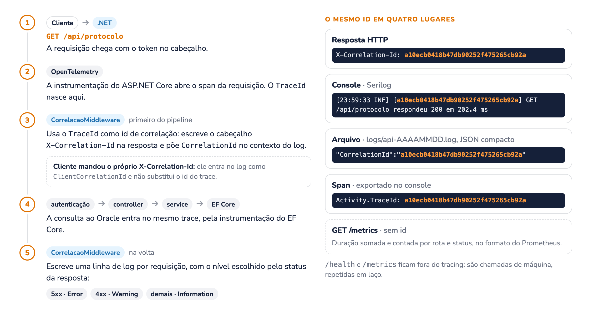

### Como monitorar

```bash
curl localhost:5297/metrics
```

**Tempo de resposta** — soma e contagem por rota e status; a média é a divisão das duas:

```
http_server_request_duration_seconds_sum{http_request_method="GET",http_response_status_code="200",...}
http_server_request_duration_seconds_count{http_request_method="GET",http_response_status_code="200",...}
```

**Taxa de erro** — a mesma métrica, agrupada pela dimensão de status:

```bash
curl -s localhost:5297/metrics | grep -oE 'http_response_status_code="[0-9]+"' | sort | uniq -c
```

Além do endpoint:

- A cada requisição, o console mostra o span (`Activity.TraceId`, rota, status).
- O `TraceId` do span é o mesmo valor do cabeçalho `X-Correlation-Id` e do `CorrelationId` em `logs/api-*.log` — com ele se acha a requisição nos três lugares.
- Para mandar a um coletor externo, basta definir `OTEL_EXPORTER_OTLP_ENDPOINT`; o `/metrics` continua respondendo do mesmo jeito.

### Health Checks

Cinco rotas expostas por `Program.cs`, sem autenticação (`AllowAnonymous`):

| Rota | O que verifica | Quando falha |
|---|---|---|
| `/health/live` | o processo está de pé | nunca — não toca banco nem dependência externa |
| `/health/db` | conexão com o Oracle | Oracle fora do ar ou connection string vazia |
| `/health/mongo` | conexão com o MongoDB da memória de cálculo | MongoDB fora do ar ou connection string errada |
| `/health/externo` | `petbuddies-ai` (Java), via `GET /actuator/health` | motor Java fora do ar ou endereço não configurado |
| `/health` | as quatro verificações acima, juntas | qualquer uma delas |

```bash
curl http://localhost:5297/health
```

O `HealthController` expõe as mesmas quatro verificações em `/api/health/live`, `/api/health/db`,
`/api/health/mongo` e `/api/health/externo` — também sem autenticação, `200` quando saudável e `503` quando não.

### Evidências

Saída da API rodando em `Development`. Os prints 03, 04 e 05 são da mesma requisição: o id em laranja é o mesmo nos três.

<table>
<tr>
<td width="50%" valign="top">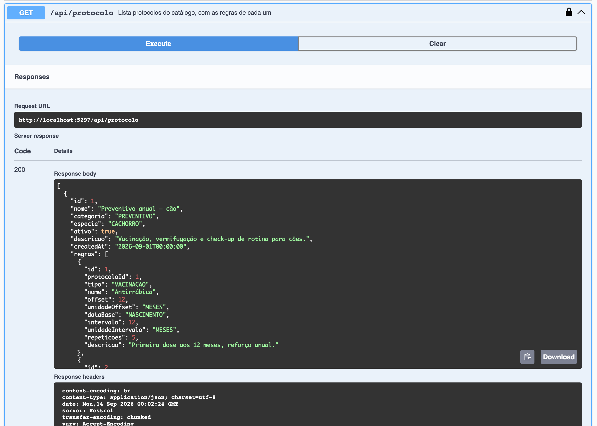<br><b>01 · Swagger</b> · token de dev no Authorize, <code>GET /api/protocolo</code> com 200</td>
<td width="50%" valign="top">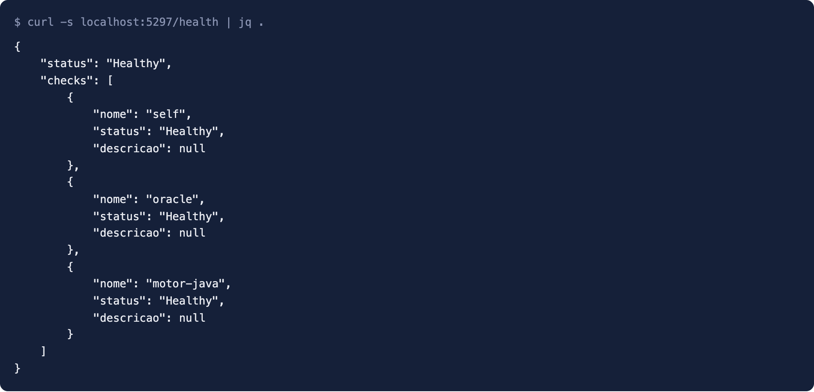<br><b>02 · Health check</b> · <code>self</code>, <code>oracle</code> e <code>motor-java</code></td>
</tr>
<tr>
<td valign="top">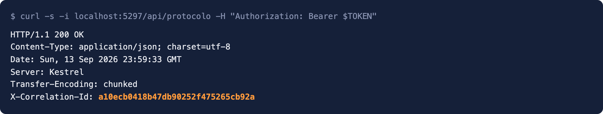<br><b>03 · Cabeçalho</b> · <code>X-Correlation-Id</code> na resposta<br><br>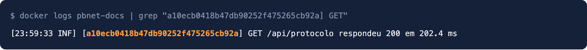<br><b>04 · Log</b> · a linha da requisição no console, com o mesmo id</td>
<td valign="top">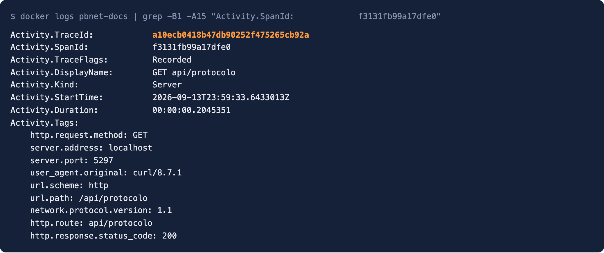<br><b>05 · Span</b> · o <code>TraceId</code> é o id de correlação</td>
</tr>
<tr>
<td colspan="2" valign="top">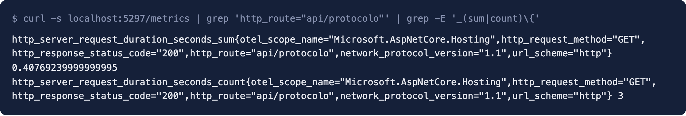<br><b>06 · Métricas</b> · soma e contagem da duração por rota e status em <code>/metrics</code></td>
</tr>
</table>

---

## Como Testar

### Via Swagger UI

Com o token de `POST /api/dev/token` preenchido em **Authorize** (passo a passo em [Como obter um token](#como-obter-um-token)), os 20 endpoints do back-office (5 por domínio × 4 domínios) e os 4 de pontuação estão disponíveis com "Try it out": `http://localhost:5297/swagger`. Para saldo e extrato, autorize com o token de `POST /api/dev/token?perfil=TUTOR&responsavelId=1`.

### Via testes automatizados

Dois projetos xUnit, quatro domínios (`Protocolo`, `RegraProtocolo`, `Oferta`, `RegraPontuacao`) × camada — Repository, Service e Controller testados em separado, com o Controller isolando o Service via mock:

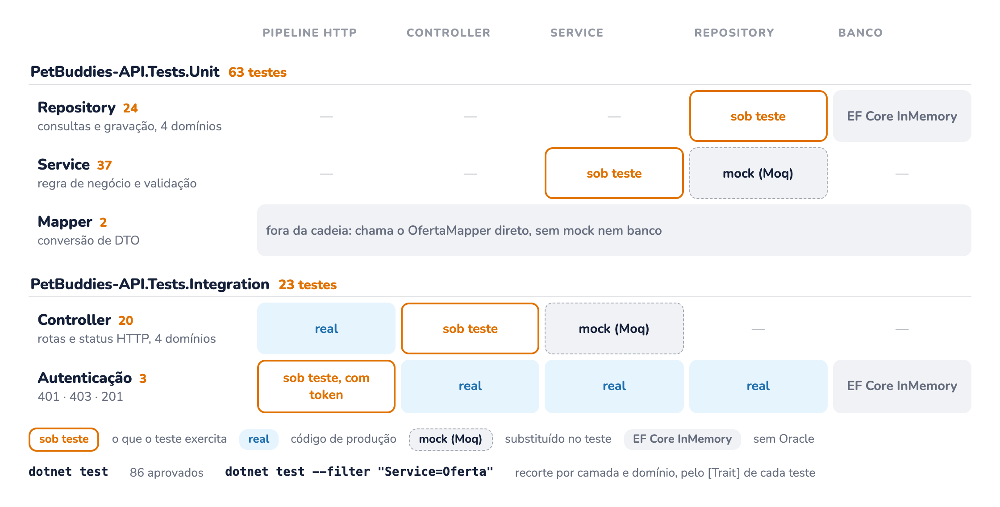

<details>
<summary>Arquivos de teste</summary>

```
PetBuddies-API.Tests.Unit/
└── App/
    ├── {Protocolo,RegraProtocolo,Oferta,RegraPontuacao}RepositoryTest.cs   # EF Core InMemory
    ├── LancamentoPontosRepositoryTest.cs                                   # EF Core InMemory: saldo, extrato e busca por consulta
    ├── {Protocolo,RegraProtocolo,Oferta,RegraPontuacao}ServiceTest.cs      # Moq sobre os repositórios
    ├── PontuacaoServiceTest.cs                                             # Moq: consulta repetida, MongoDB fora do ar, regras vigentes
    ├── CalculadoraDePontosTest.cs                                          # regra pura: critérios, bônus de adesão, sem regra vigente
    └── OfertaMapperTest.cs                                                 # OfertaMapper.Aplicar, sem repositório

PetBuddies-API.Tests.Integration/
└── App/
    ├── {Protocolo,RegraProtocolo,Oferta,RegraPontuacao,Pontuacao}ControllerTest.cs  # WebApplicationFactory + Service mockado (CustomWebApplicationFactory)
    ├── LimiteDeRequisicoesTest.cs                                         # rate limit: a requisição acima do limite volta 429 com Retry-After
    └── AutenticacaoTest.cs                                                # app real, sem mock — sem token (401), token TUTOR (403), token VET (201)
```

</details>

Todo teste é escrito em Arrange / Act / Assert e nomeado `MetodoTestado_Cenario_ResultadoEsperado`
(ex.: `ObterPorIdAsync_RegraExistente_RetornaARegra`). O contexto compartilhado vem de fixtures:
`RequestBuilderFixture` como Collection Fixture dos testes de service, `PetBuddiesApiFixture` como
Collection Fixture do teste de autenticação e `CustomWebApplicationFactory` como `IClassFixture`
dos testes de controller e de rate limit.

Rodar tudo:

```bash
dotnet test
```

**124 testes, todos passando** (88 no `.Tests.Unit`, 36 no `.Tests.Integration`). Tudo roda contra `Microsoft.EntityFrameworkCore.InMemory`, e o MongoDB entra mockado: não precisa de Oracle, MongoDB, VPN nem container.

Todo teste tem `[Trait]` de camada e domínio — dá para rodar só um recorte:

```bash
dotnet test --filter "Repository=Protocolo"
dotnet test --filter "Service=Oferta"
dotnet test --filter "Mapper=Oferta"
dotnet test --filter "Controller=RegraPontuacao"
dotnet test --filter "Autenticacao=Protocolo"
dotnet test --filter "LimiteDeRequisicoes=Oferta"
dotnet test --filter "Calculadora=Pontuacao"
dotnet test --filter "Controller=Pontuacao"
```

### Via Postman

A coleção em `docs/postman/petbuddies-api-net.postman_collection.json` cobre os quatro domínios do back-office e a pontuação.

- Importe o arquivo.
- Com a API, o Oracle e o MongoDB de pé, rode a coleção inteira em ordem — ou qualquer requisição avulsa. O token é pedido à própria API e gravado sozinho, pela pasta `0 · Token` ou, se a variável estiver vazia ou vencida, pelo script da coleção. Não há segredo para configurar no Postman.
- O que cada pasta cobre: `1 · Saúde` as nove rotas de health check; `2 · Protocolo`, `3 · Regra de protocolo`, `4 · Oferta` e `5 · Regra de pontuação` o CRUD de cada domínio, com os erros que o controller declara; `6 · Pontuação` cria as regras dos gestos novos, lança os pontos de uma consulta, reenvia a mesma sem pontuar de novo e lê saldo, extrato e memória de cálculo com um token de tutor; `7 · Limpeza` remove o que a execução criou.
- `8 · Login no Java (opcional)` só responde com o `petbuddies-ai` no ar; sem ele, essa requisição falha e pode ser ignorada.

---

## Exemplos de Payload (POST)

> Todas as rotas exigem `Authorization: Bearer <token com role VET>`.

#### `POST /api/protocolo`
```json
{
  "nome": "Preventivo cão adulto",
  "categoria": "PREVENTIVO",
  "especie": "CACHORRO",
  "ativo": true,
  "descricao": "Vacinação e vermifugação anuais"
}
```

#### `POST /api/regra-protocolo`
```json
{
  "protocoloId": 1,
  "tipo": "VACINACAO",
  "nome": "V10 anual",
  "offset": 0,
  "unidadeOffset": "DIAS",
  "dataBase": "ULTIMA_REALIZACAO",
  "intervalo": 12,
  "unidadeIntervalo": "MESES",
  "repeticoes": 1,
  "descricao": "Reforço anual da V10"
}
```

#### `POST /api/oferta`
> `subtipo` + `protocoloId` são mutuamente exclusivos: `ato: PROTOCOLO` exige `protocoloId` e proíbe `subtipo`; `PROCEDIMENTO`/`CONSULTA` exigem `subtipo` e proíbem `protocoloId`.
```json
{
  "clinicaId": 1,
  "ato": "PROTOCOLO",
  "protocoloId": 1,
  "descricao": "Plano preventivo cão adulto",
  "valor": 180.00,
  "inicioVigencia": "2026-10-01"
}
```

#### `POST /api/regra-pontuacao`
```json
{
  "clinicaId": 1,
  "gesto": "CONSULTA_REALIZADA",
  "pontos": 10,
  "inicioVigencia": "2026-10-01"
}
```

`gesto` aceita `PLANO_CRIADO`, `CONSULTA_AGENDADA`, `CONSULTA_REALIZADA`, `PROCEDIMENTO_EXECUTADO`,
`CHECKIN_REGISTRADO`, `ADESAO_COMPLETA` e `EVOLUCAO_POSITIVA`.

#### `POST /api/pontuacao/consulta`
> Em produção quem envia é o Java, ao fechar a consulta. `dataConsultaAnterior` é nula na primeira
> consulta do animal, e `evolucao` (`MELHOROU`, `ESTAVEL`, `PIOROU`) é opcional.
```json
{
  "consultaId": 42,
  "responsavelId": 1,
  "animalId": 3,
  "clinicaId": 1,
  "dataConsulta": "2026-10-01T14:30:00",
  "dataConsultaAnterior": "2026-09-01T10:00:00",
  "dosesPrevistas": 20,
  "dosesComCheckin": 18,
  "diasNoPeriodo": 30,
  "diasComCheckin": 17,
  "acionamentosClinica": 1,
  "evolucao": "MELHOROU"
}
```
